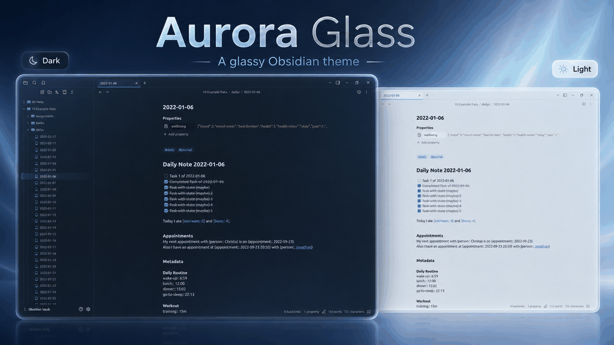

# Aurora Glass

A graphite-blue glass theme for Obsidian, forked from
[OtmiVi/aurora_glass](https://github.com/OtmiVi/aurora_glass), which in turn is
customized from [Oczko24's Obsidian Transparent](https://github.com/Oczko24/Obsidian-transparent).

This fork keeps that look but removes a background animation that pushed an M2 to
~90% GPU while idle, and drops CSS that never reached the screen.

## Install

The community-theme browser entry for "Aurora Glass" still points at upstream, so
installing from the browser installs the upstream build, not this one.

Manual install:

1. Download `theme.css` and `manifest.json` from this repository.
2. Put both files in `<vault>/.obsidian/themes/Aurora Glass/`.
3. Reload Obsidian and pick **Aurora Glass** under Settings → Appearance.

An official theme update will overwrite this folder. Re-copy the two files after
one, or install under a different folder name.

## Highlights

- Dark and light graphite-blue glass palettes.
- Transparent, gradient, solid-colour and custom-image backgrounds. These are
  opt-in body classes (`bg-gradient`, `bg-solid`, `bg-custom`,
  `preset-true-glass`, `preset-orange`); the theme ships no Style Settings
  panel, so add the class with a CSS snippet or a plugin that can set body classes.
- Tuned settings modal, community theme browser, tabs, file explorer, canvas,
  code blocks, marks and inline code.
- Partial compatibility for Make.md, Notebook Navigator and Enchanted Animations.

## Fork changes (vvbzv)

1. **Transparent window chrome on all desktop platforms.** `.titlebar`,
   `.workspace-ribbon.mod-left::before`, `.titlebar-button-container.mod-right`
   and `.workspace-tabs.mod-top` read `--titlebar-background` /
   `--tab-container-background`; the opaque values hid the gradient in the
   traffic-light corner and left a flat square above the left ribbon on Windows.
   The macOS part is offered upstream as
   [PR #2](https://github.com/OtmiVi/aurora_glass/pull/2) (open); the
   Windows and Linux selectors are fork-only.

2. **Static background by default.** The default backgrounds ran a 55s infinite
   `alternate` animation on `background-position` across a fixed pseudo-element
   inset by `-2 * background-blur` (80px) and carrying
   `filter: blur(80px) saturate()`. `background-position` is not compositable,
   so that layer was repainted and re-blurred every frame. GPU Device Utilization
   on an M2, Obsidian 1.13.6, idle window, 6 samples:

   | config | avg | max |
   | --- | --- | --- |
   | Obsidian closed | 22–33% | — |
   | another theme (Tokyo Night) | 30% | 39% |
   | upstream Aurora Glass | **90%** | 92% |
   | this fork | **29%** | 34% |

   The two `animation` lines are commented out, not deleted; uncomment them in
   both background rules for the ambient drift. Transform-based keyframes measured
   74%, so the drift is off rather than rewritten. Windows and Linux were not
   measured; the change there is visual only.

3. **Dead CSS removed.** Three shadowed generations of the default background,
   two dead tab systems, duplicate keyframes and theme-private variables no rule
   read are gone (345 lines, 7.5 KB of 108.5 KB). Every removal was checked for cascade
   equivalence: the effective declaration set for each selector is unchanged.
   Fixed along the way: `.menu-scroll` no longer breaks long-menu scrolling, the
   splash overlay no longer paints a transparent layer, the sync error icon uses
   `--text-error`, the `no-animation` kill switch now actually applies, dark
   settings are opaque like light, and `prefers-reduced-motion` is honoured.

## License

GPL-3.0-only, inherited from Obsidian Transparent. See [LICENSE](LICENSE).
Upstream and original authors retain copyright; this fork's modifications are
marked in the header of `theme.css`.
